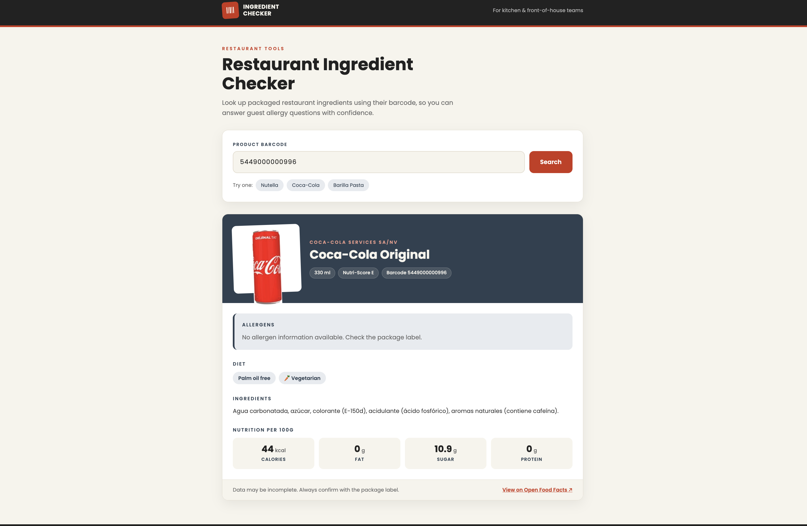

# 🍽️ Restaurant Ingredient Checker

A quick lookup tool for restaurant staff. Enter the barcode from a packaged ingredient to see its brand, ingredient list, allergens, and nutrition facts.

> Built a simple front-end app that displays data returned from an API that would be beneficial to someone working at or managing a restaurant.

🔗 **Live Demo:** [kareemahb.github.io/api-restaurant](https://kareemahb.github.io/api-restaurant/)



## ✨ Features

- **Barcode search**: press **Search** or **Enter**. The field only accepts numbers and checks the length before searching.
- **Quick examples**: one-click buttons for Nutella, Coca-Cola, and Barilla pasta
- **Product card** with:
  - Product photo, brand, package size, and Nutri-Score
  - **Allergen alert**: allergens highlighted in red so staff can answer guest questions fast
  - **"May contain traces of"** warnings for cross-contact
  - **Diet tags** such as vegan and vegetarian, when the data shows them
  - Ingredient list
  - Nutrition per 100 g: calories, fat, sugar, and protein
  - A link to the full product page on Open Food Facts
- **Fallbacks**: missing fields show "Unknown," "Not available," or "N/A" instead of breaking the page
- **Status messages**: a loading spinner while searching, and clear errors for a blank input, an invalid barcode, or an unknown product
- **Responsive design** for tablets and phones in the kitchen

## 🔍 How It Works

```
Barcode ──▶ Open Food Facts API ──▶ product JSON ──▶ product card
```

1. The `FoodApi` class builds the request to the [Open Food Facts API](https://openfoodfacts.github.io/openfoodfacts-server/api/) (`/api/v2/product/{barcode}.json`), asking only for the fields the app needs
2. Submitting the form (the **Search** button or **Enter**) validates the barcode and calls `foodApi.getProduct()`
3. `displayProduct()` builds the product card from the response. Text from the database is escaped before it goes on the page, because Open Food Facts is edited by the community.
   Open Food Facts is free and needs no API key.

### Barcodes to try

Use the number printed under the barcode on a package (UPC or EAN), or browse [world.openfoodfacts.org](https://world.openfoodfacts.org/) to find one. For example, `3017624010701` is Nutella.

## 🎨 Design

| Color | Hex       |
| ----- | --------- |
| Red   | `#CC3314` |
| Black | `#1C1C1C` |
| Navy  | `#2C3E50` |
| Gray  | `#6B6B6B` |
| Cream | `#F7F4ED` |

Font: [Poppins](https://fonts.google.com/specimen/Poppins), Bold for headings and Regular for body text.

## 🛠️ Tech Stack

- HTML5
- CSS3
- JavaScript (ES6 classes, `async`/`await`, Fetch API, template literals)
- [Open Food Facts API](https://openfoodfacts.github.io/openfoodfacts-server/api/)
  No frameworks, dependencies, or build tools.

## 📁 Project Structure

```
api-restaurant/
├── index.html   # Header, barcode search, and result area
├── main.css     # Styling and color palette
├── main.js      # FoodApi class and product display
└── image.png    # README screenshot
```

## 🚀 Getting Started

Try it live on **[GitHub Pages](https://kareemahb.github.io/api-restaurant/)**, or run it locally:

```bash
git clone https://github.com/kareemahb/api-restaurant.git
cd api-restaurant
```

Open `index.html` in your browser, or use the **Live Server** extension in VS Code.

## 💡 What I Learned

- Wrapping API calls in a class to keep request logic separate from the page
- Requesting only the fields I need to keep responses small
- Building HTML from API data with template literals
- Handling missing data with fallbacks, optional chaining (`?.`), and nullish coalescing (`??`)
- Reading API docs carefully: Open Food Facts names its nutrition field `nutriments`, not `nutrients`
- Escaping user-edited data before putting it on the page
- Using a `<form>` so the Enter key and the button share one submit handler

## ⚠️ Disclaimer

Product data comes from Open Food Facts, a community-edited database, and may be incomplete or out of date. Always check the product label for allergens.

## 👩‍💻 Created By

**Kareemah Bahaadur**
[GitHub](https://github.com/kareemahb)
